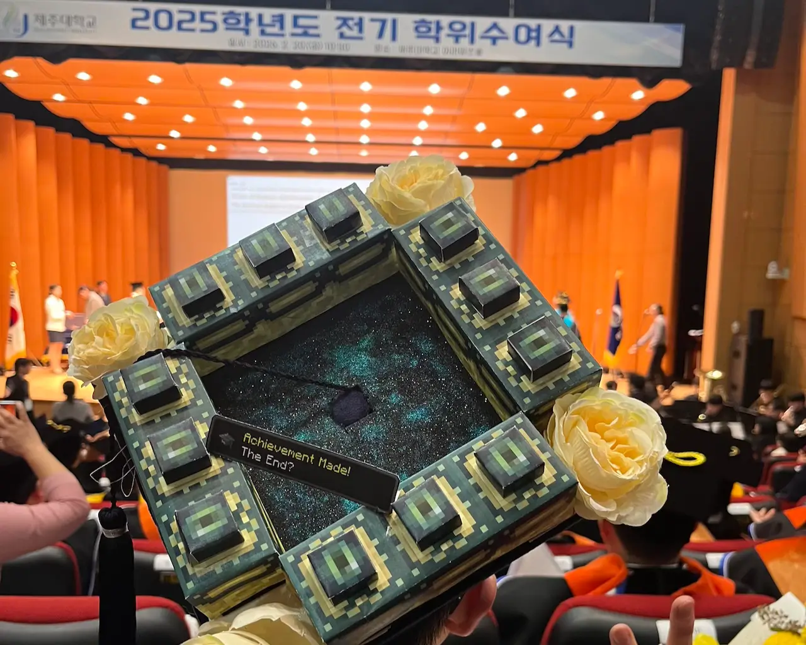

# Enjoy Campus Life

Note-taking for computer engineering lectures and assignments

> [!NOTE]
> 
> Graduate! 🎓 (<time datetime="2018-03-02">2018-03-02</time> – <time datetime="2026-02-20">2026-02-20</datetime>)

## Tips for Using Campus ICT Services

- [Jeju National University Portal](https://portal.jejunu.ac.kr)
  - Install the [SSO login automation userscript](https://github.com/mu-hun/jejunu-sw/raw/refs/heads/master/portal.user.js)
  - [mu-hun/jejunu-icalendar-server](https://github.com/mu-hun/jejunu-icalendar-server/) 
    An automated workflow to subscribe your lecture timetable to external calendars

- [Jeju University LMS (JNU CLASS)](https://jnuclass.jejunu.ac.kr)
  1. Install the [login page redirection userscript](https://github.com/mu-hun/jejunu-sw/raw/refs/heads/master/jnuclass-redirect-to-login.user.js)
  2. Install the [login automation userscript](https://github.com/mu-hun/jejunu-sw/raw/refs/heads/master/jnuclass-auto-login.user.js)

## Collection of Practice Assignments

- Principles and Paradigms of Computing (an introduction to computer science based on computer graphics)
  > Professor: The second assignment will be a rotation animation~ 
  > Me: Submitted via https://github.com/mu-hun/strom
- Eodeme (Korean: 어데메, pronounced 'uh-deh-me') 🔍 – a mini-game for discovering various places in Jeju Island: https://github.com/eodeme/eodeme
- Bomb-shelter survival game project inspired by Discord chat experience
  - [Game flowchart](https://gist.github.com/mu-hun/aaa84e2f1eef326062d542f8731940fb#file-flow-mmd), [demo video](https://gist.github.com/user-attachments/assets/0cd141f2-0b01-4b48-89df-9cc1ed79394b)
  - I was responsible for designing the [LLM communication adapter](https://gist.github.com/mu-hun/aaa84e2f1eef326062d542f8731940fb#file-agent_adapter-py)[^Adapter] used by the Discord bot.
- Web application assignment applying chart UI: [Project proposal (presentation)](https://speakerdeck.com/muhun/team-slicon?slide=8)
  - Implementation of sorting algorithm visualization and sonification: https://github.com/ez-25/team-silicon/pull/1
  - Cryptocurrency chart demo (code review): https://github.com/ez-25/team-silicon/pull/8
- Embedded software — rhythm game key-input LED visualization project: [PLATiNA-LED](https://github.com/mu-hun/PLATiNA-LED)

[^Adapter]: The term comes from the Ports & Adapters pattern (also known as Hexagonal Architecture). "Port" refers to the internals and "Adapter" refers to the externals. See Alistair Cockburn's introduction to the pattern: https://web.archive.org/web/20140329201018/http://alistair.cockburn.us/Hexagonal+architecture.

---

_This repository was inspired by [simnalamburt/snucse](https://github.com/simnalamburt/snucse)_

Original contents are copyrighted to Lecturer, and Notes is primarily distributed under the terms of the [GNU Affero General Public License v3.0](./LICENSE) or any later version. See [COPYRIGHT](./COPYRIGHT) for details.
